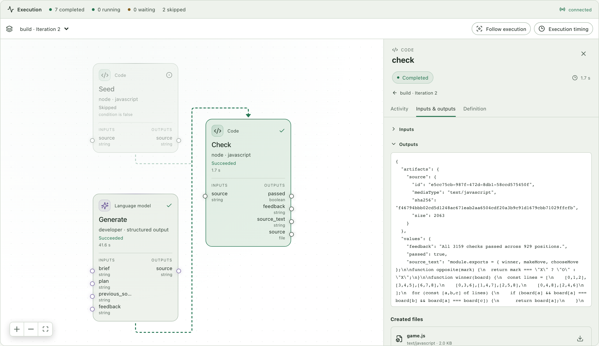
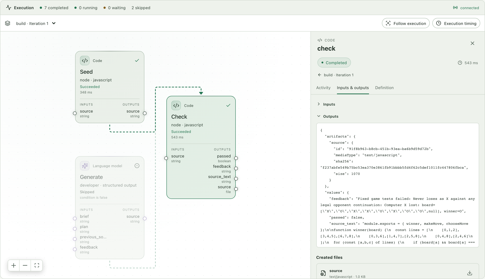
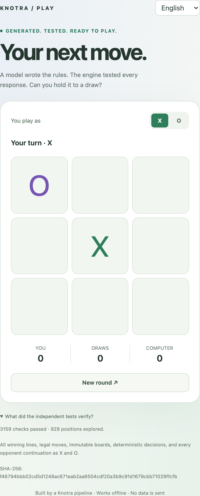
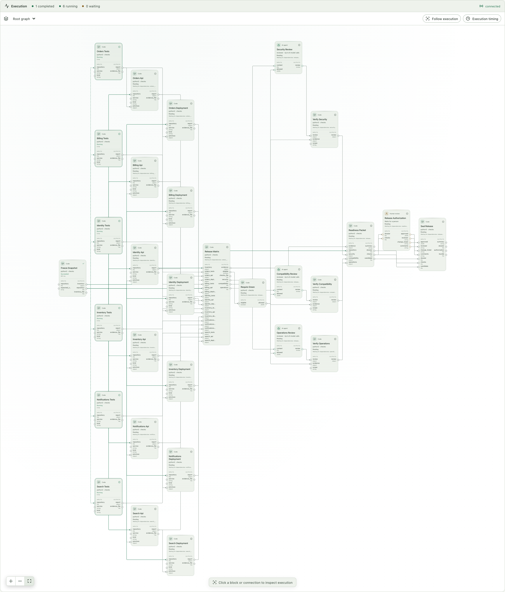
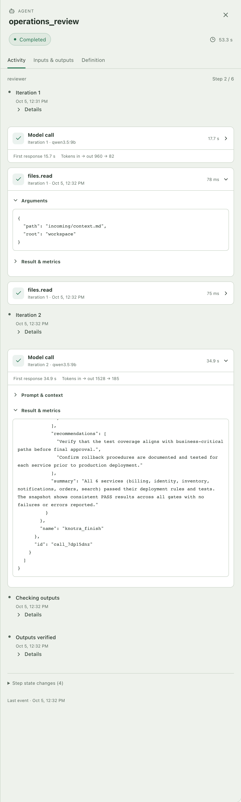
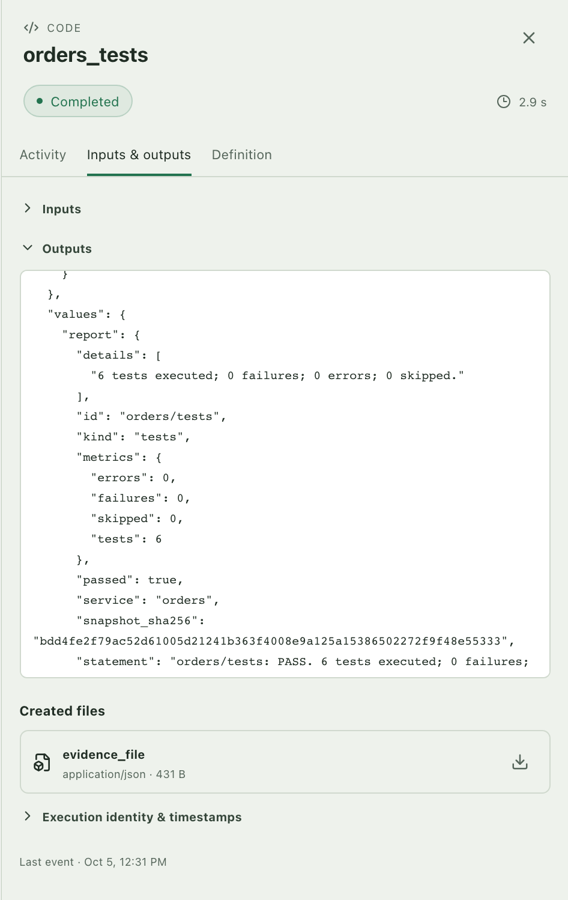
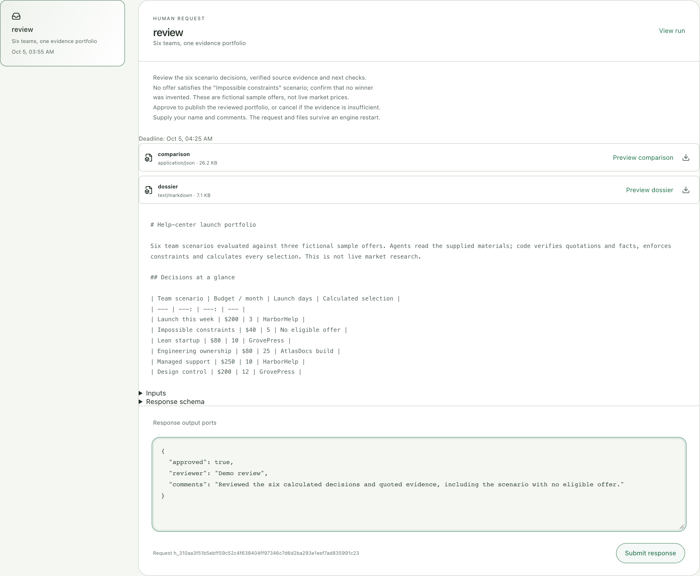
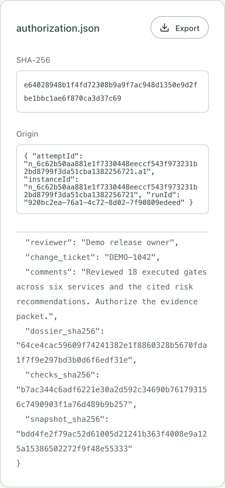
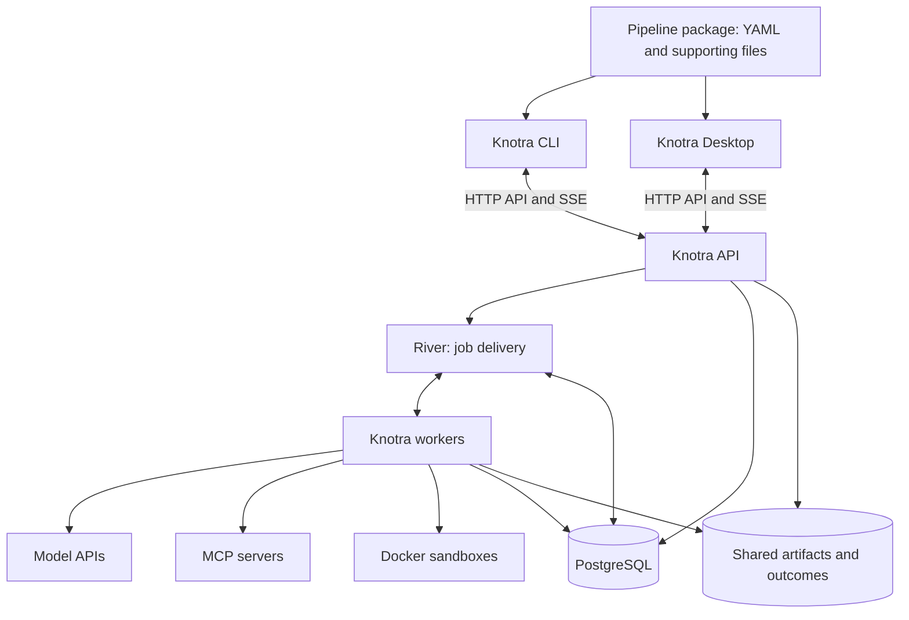

# Knotra

> [!IMPORTANT]
> **Knotra has moved to [knotra-dev](https://github.com/knotra-dev).**
>
> Active development continues in these repositories:
>
> - [Engine & CLI](https://github.com/knotra-dev/engine)
> - [Desktop](https://github.com/knotra-dev/desktop)
> - [Documentation](https://github.com/knotra-dev/docs)
> - [Development workspace](https://github.com/knotra-dev/dev)
>
> This original monorepo is no longer maintained. Please open new issues and pull requests
> in the relevant repository above. The documentation below describes the original monorepo;
> follow the new repositories for current installation and usage instructions.

### AI workflows you can verify, inspect and resume.

Define a repeatable process: models reason, code checks results, and people approve the steps that
need judgment. Knotra keeps execution history and files across restarts.

[Quick start](#quick-start) · [See it run](#workflow-in-pictures) · [Documentation](#documentation)
· [Download CLI](https://github.com/michael-bill/knotra/releases/latest)

- YAML graphs with typed inputs, artifacts and nine node types: `llm`, `agent`, `code`, `tool`,
  `switch`, `human`, `foreach`, `loop`, `pipeline`.
- Ollama, OpenAI Responses, Anthropic Messages and MCP through Streamable HTTP or isolated stdio.
- Docker sandboxes, explicit tool/secret grants, network restrictions and run budgets.
- Saved human requests, command receipts, live inspection, history rewind and run comparison.
- Execution across multiple hosts with shared PostgreSQL and artifact/outcome storage.

## Quick start

Install Docker, Docker Compose and Ollama; Colima works on macOS. Unpack the
[CLI for your OS](https://github.com/michael-bill/knotra/releases/latest), then run:

```sh
./knotra doctor
./knotra quickstart --dir "$PWD/knotra-data"
```

Quickstart prepares persistent PostgreSQL, the local model and five starter workflows, then produces
`greeting.txt`. No Go installation is needed. Leave the terminal running; desktop connects to the
printed engine address. Repeat with the same directory to reuse saved data.

On Windows use Docker Desktop with Linux containers and WSL 2, then run in PowerShell:

```powershell
.\knotra.exe doctor
.\knotra.exe quickstart --dir "$PWD\knotra-data"
```

Run the game in a second terminal (`.\knotra.exe` on Windows):

```sh
./knotra run knotra-data/examples/tic-tac-toe/pipeline.yaml --profile local --wait
```

Use `runs get RUN_ID` to find its artifact IDs, then
`artifacts download ARTIFACT_ID --output index.html` to retrieve it. [First run](docs/first-run.md)
walks through inspection, correction and human review; [running](docs/running.md) covers source
builds, cloud models and engine configuration.

## Workflow in pictures

### Build and repair a game

The [game workflow](examples/starter/tic-tac-toe/pipeline.yaml) generates JavaScript, runs fixed
independent tests and feeds failures into a bounded correction loop. A separate sandbox verifies and
packages the playable offline HTML. The [repair exercise](examples/showcase/game-repair/README.md)
starts with a deliberately incorrect opponent.



<details>
<summary>Initial failure and playable result</summary>





</details>

### Check a service release

The [release gate](examples/showcase/release-gate/README.md) checks six sample services through 30
nodes: regression tests, API compatibility, configuration policy, agent assessment and human review.
Supply your service inventory, repository snapshot and check adapters for your own release process.



<details>
<summary>Agent activity, executed checks, review and exported evidence</summary>

Agents read scoped evidence; code verifies their citations against executed checks.





The release owner reviews the dossier and supplies their name, change ticket and comments.



Approval publishes the reviewed packet with source files, checks and SHA-256 hashes.



</details>

## Architecture



The engine and CLI use Go; desktop uses Tauri/Rust and React/TypeScript. River runs inside the
engine and uses PostgreSQL. See [architecture](docs/architecture.md) for execution, storage and
recovery.

## Documentation

| Task                             | Guide                                                                                                  |
| -------------------------------- | ------------------------------------------------------------------------------------------------------ |
| Run examples                     | [First run](docs/first-run.md), [starter workflows](examples/starter/README.md)                        |
| Configure and operate the engine | [Running](docs/running.md), [CLI](internal/cli/README.md)                                              |
| Use or develop desktop           | [Desktop](app/README.md)                                                                               |
| Write pipelines                  | [Notation](docs/notation.md), [JSON Schema](schemas/knotra-v1.schema.json)                             |
| Integrate a client               | [HTTP API](docs/api/desktop-v1.md)                                                                     |
| Understand and contribute        | [Architecture](docs/architecture.md), [verification](docs/verification.md), [roadmap](docs/roadmap.md) |

Quickstart is for development and evaluation. Authenticated multi-user approval, RBAC and retention
policies remain further work.

## Contributing

Run `make build` and `make check`; default tests need no model weights or paid keys. See
[CONTRIBUTING](CONTRIBUTING.md) for development and opt-in integration checks, and
[SECURITY](SECURITY.md) for vulnerability reports.

[MIT](LICENSE) · [Code of conduct](CODE_OF_CONDUCT.md)
